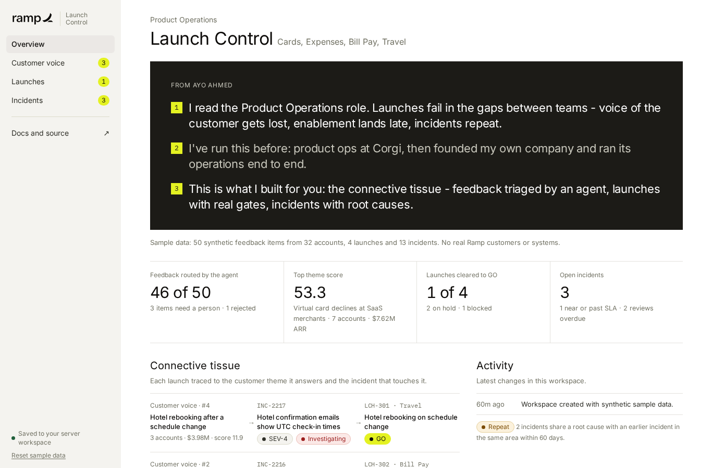
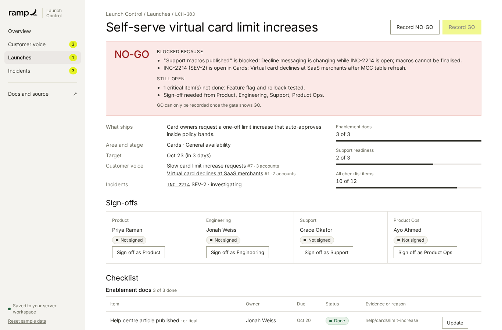
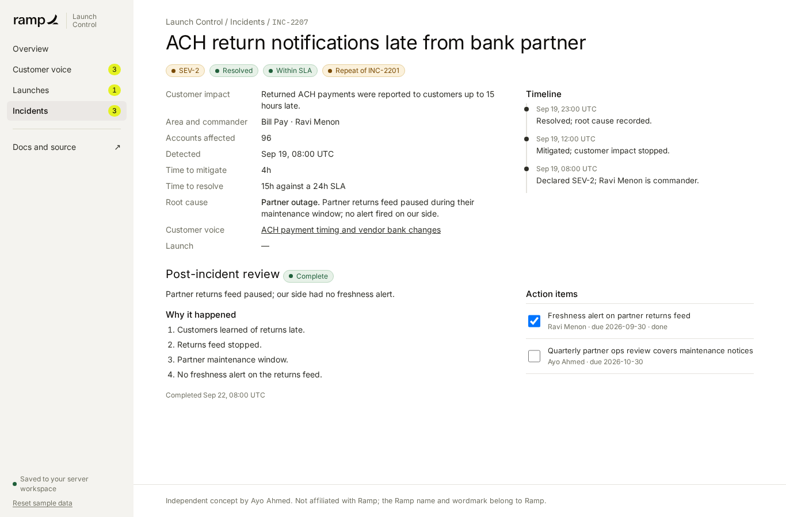
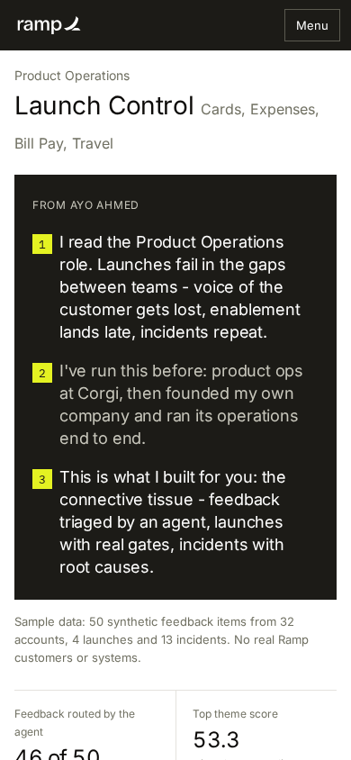

<p></p>

# Ramp Launch Control

A product-operations command centre: customer voice triaged by an agent, launches with real gates, and incidents driven to root cause.

> I read the Product Operations role. Launches fail in the gaps between teams - voice of the customer gets lost, enablement lands late, incidents repeat.
>
> I've run this before: product ops at Corgi, then founded my own company and ran its operations end to end.
>
> This is what I built for you: the connective tissue - feedback triaged by an agent, launches with real gates, incidents with root causes.

Sample data only: 50 synthetic feedback items from 32 accounts, 4 launches and 13 incidents. No real Ramp customers or systems.



## What it does

**Customer Voice.** A triage agent sorts each feedback item (Cards, Expenses, Bill Pay, Travel) into one of 12 themes and routes it to the owning area with a written rationale: matched phrases, score, owner and the runner-up it beat. It sends low-signal or cross-area items to a person instead of guessing. Themes are scored as distinct accounts × ARR in $M, and need 3+ accounts to rank, so one loud account can't top the list. CSV import is all-or-nothing.

**Launch Readiness.** Each launch has a checklist (enablement docs, support readiness, quality, comms, measurement) and four sign-offs. GO requires every critical item done with evidence, enablement done 2 days early, no open SEV-1/2 in the area, and sign-offs that match the current checklist. Seeded: one ready (GO), one mid-flight (HOLD), one blocked (NO-GO, open SEV-2 and blocked support macros), one early.

**Incident Board.** Severity, commander, customer impact, timeline, time to mitigate and resolve against SLA, root-cause notes, repeat detection within 60 days, and post-incident reviews (summary, whys, owned action items) for every resolved SEV-1 to SEV-3.

| Launch blocked | Incident review | Mobile |
| --- | --- | --- |
|  |  |  |

## Run it

```bash
npm ci
npm run dev          # builds, then Worker + Durable Object on http://localhost:8787
npm run check        # typecheck, unit tests, evals, build, wrangler dry run
npm run test:api     # API boundary checks against the running Worker
npm run ui:check     # Playwright + axe at 1366px and 390px
```

Deploying: [docs/DEPLOY.md](docs/DEPLOY.md) (Cloudflare Workers, GitHub Pages fallback).

## How it's built

React and Vite UI, a pure TypeScript engine, and a Cloudflare Worker with one SQLite Durable Object per visitor. Every write goes through one command endpoint with an allowlist, an idempotency key and a revision check. The static build runs the same engine in the browser. The triage agent is deterministic and makes no model calls.

## Documents

- [PRD](docs/PRD.md) · [ELI5](docs/ELI5.md) · [Five Whys](docs/FIVE_WHYS.md) · [Jobs to be done](docs/JTBD.md) · [Metrics](docs/METRICS.md)
- [Test plan and results](docs/TEST_PLAN.md) · [Viability memo](docs/VIABILITY_MEMO.md) · [v2 roadmap](docs/ROADMAP_V2.md) · [Decision log](docs/DECISION_LOG.md)
- [Design system](DESIGN.md) · [Brand guide](docs/brand/BRAND_GUIDE.html) · [Public tour notes](docs/RAMP_PUBLIC_TOUR_NOTES.md) · [Sources](docs/SOURCES.md) · [AGENTS.md](AGENTS.md)

---

Independent concept by Ayo Ahmed. Not affiliated with Ramp; the Ramp name and wordmark belong to Ramp.
